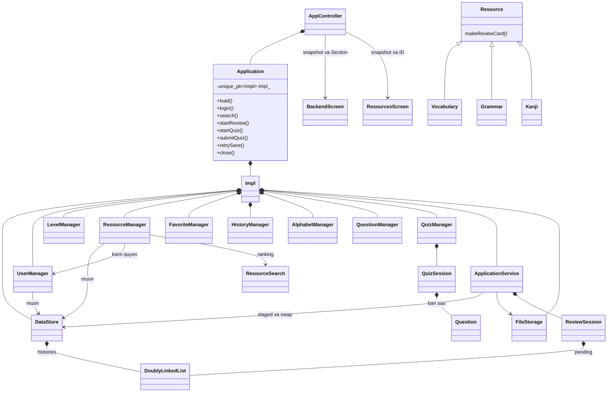
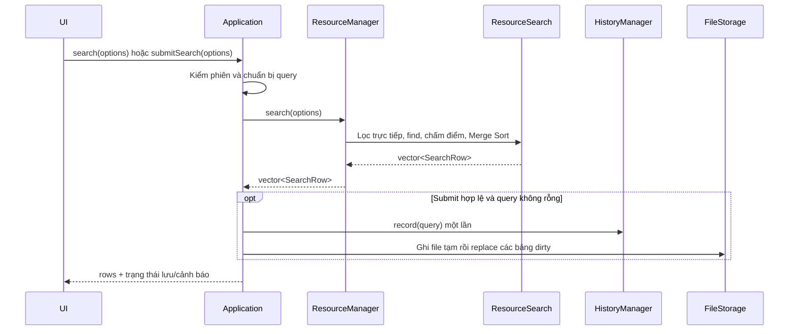
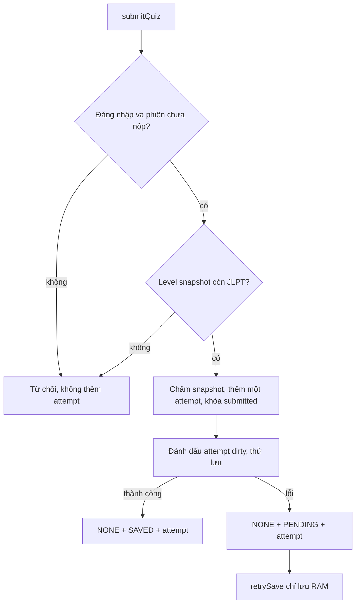

# Kiến trúc backend

## Phân chia trách nhiệm

Frontend nối target `pbl2_backend` và include `pbl2/Application.h`. Application xác thực actor từ phiên, kiểm quyền, điều phối nghiệp vụ, tự thử lưu và trả snapshot theo giá trị. `src/application/Application.cpp` sở hữu Impl, giữ DataStore, manager và FileStorage bên trong target. UserRole/UserStatus công khai để UI vẽ menu. User và credential nằm trong `src/domain/`, hashing và verify qua libsodium ở đó.

AppController điều phối vòng đời cửa sổ, phiên và navigation theo `Section`. Các module action tra cứu, quản trị và học chuyển event chứa ID thành lệnh Application. Screen nhận snapshot và vẽ hoặc phát event. Manager tiếp tục kiểm quyền khi được gọi từ nội bộ. ApplicationService điều phối cascade học liệu/yêu thích, import staged, tạo review và đường lưu. FileStorage xử lý TXT và tính hợp lệ kho.

Các manager còn lại cũng mượn DataStore và UserManager, không sở hữu kho thứ hai. Quan hệ trong sơ đồ rút gọn theo vai trò, tên method thực tế xem header.

## Ownership và lifetime

| Quan hệ | Vòng đời thật và ý nghĩa |
|---|---|
| Application → Impl → DataStore/managers/storage | Composition: hủy Application thì các member được hủy; thứ tự khai báo tạo data trước manager |
| DataStore → vector entity và DLL histories | Composition, entity theo giá trị; không có delete thủ công cho Resource |
| DoublyLinkedList → Node → T | Composition: mỗi list sở hữu node riêng, Node.data khởi tạo trực tiếp, không đòi default constructor |
| Manager → DataStore&/UserManager& | Association không sở hữu, tham chiếu sống lâu cùng Impl |
| Favorite → UserId/ResourceId; Resource → LevelId | Association qua danh tính, không giữ pointer vào vector |
| SearchRow | Snapshot theo giá trị từ các vector học liệu được duyệt trực tiếp |
| ReviewSession/QuizSession → nội dung phiên | Composition của các bản sao, không bị vector nguồn realloc/xóa làm dangling |

Resource trừu tượng có destructor virtual, copy/assignment protected để tránh slicing. Ba lớp con final có copy theo giá trị. `ApplicationService::startReview` gọi `makeReviewCard()` đa hình để tạo thẻ theo loại học liệu.

Entity string/số/enum/ID dùng quy tắc mặc định cho copy/destructor. Copy entity giữ ID, không sinh ID mới. DoublyLinkedList tự quản lý destructor/deep copy/copy-and-swap; copy lỗi clear chuỗi node đã dựng rồi ném lại. Không viết move riêng: rvalue có thể dùng copy an toàn; swap hai list O(1). Application cấm copy/move để tránh manager trỏ sang kho của object khác. Session copy giữ nội dung độc lập; UI chỉ nhận view theo giá trị đã bỏ trường nhạy cảm.

## Luồng chính

Xóa Resource cần actor admin, ID tồn tại và không còn Question tham chiếu. ApplicationService sao chép DataStore staged, xóa Resource và Favorite liên quan, rebuild/validate rồi swap và đánh dấu bảng dirty. Import kiểm đường dẫn, toàn bộ gói và xung đột ID/nội dung Level trước khi swap. FileStorage cũng dùng staging khi load. Khi lưu, FileStorage tạo độc quyền file tạm cùng thư mục, hoàn tất ghi và đóng trước replace. Mỗi replace thành công xóa dirty riêng. Nếu replace giữa chừng lỗi, `retrySave` lưu phần dirty còn lại từ RAM. Thao tác replace có phạm vi từng file.

Login giữ optional<UserId>; epoch thay đổi mỗi login/logout. Review/quiz chỉ được trả khi epoch trùng. Application còn reset trực tiếp các phiên khi đổi tài khoản/load. Snapshot UI cũ có thể vẫn tồn tại trong bộ nhớ UI, nhưng không thể dùng nó làm capability để sửa phiên cũ hoặc truy cập dữ liệu user khác.

## CTDL, thuật toán và độ phức tạp

N là số Resource, I là tổng entity có chỉ mục, H/F/Q là số history/favorite/question, E là số câu đủ điều kiện, k là số kết quả hoặc câu chọn. Hash, so sánh và sao chép string còn phụ thuộc độ dài string.

| Thao tác | Chi phí và lý do |
|---|---|
| Lookup ID | Trung bình O(1), xấu nhất O(N) phép tra băm; index lưu vị trí số |
| Rebuild index | Trung bình O(I), phát hiện trùng; vector erase làm dịch vị trí nên phải rebuild |
| CRUD có rebuild | Có chi phí rebuild và/hoặc dịch vector, không phải O(1) toàn thao tác |
| Search nội dung | Duyệt các vector phù hợp, tìm bằng `string_view::find`, rồi O(k log k) so sánh để sort |
| Merge Sort | O(k log k) so sánh, O(k) buffer copy, O(log k) stack; khi tương đương lấy trái trước |
| Favorite add/list | O(F) quét cặp/user; không có cache phụ dư thừa |
| History listNewest/clear | O(H), duyệt ngược hoặc eraseIf; không sort timestamp mỗi lượt |
| Review mỗi bước | O(1) thao tác node, cộng copy thẻ; tạo review còn quét F và tra ID |
| Start quiz | O(Q) lọc, O(E) shuffle, O(k) copy; một engine, không seed từng câu |
| Submit quiz | O(k) chấm, cấp AttemptId còn quét attempts, rồi serialize các bảng dirty |
| Staged import/xóa | Copy O(kích thước kho), rebuild/validate và ghép/xóa; quan hệ Favorite/Question còn phải quét |
| Save | Serialize theo số byte của các bảng dirty. Mỗi replace thành công xóa dirty của bảng đó |

List invariant: rỗng thì head/tail null và count=0; không rỗng head.prev/tail.next null; next/prev đối xứng; count bằng node thật. Node private, không lộ ownership ra API. Callbacks forEach không được sửa cấu trúc cùng list; xóa khi duyệt dùng eraseIf.

Tra cứu fold A–Z ASCII và giữ byte UTF-8 còn lại. Mỗi field có một vị trí khớp dùng cho các mức điểm liên quan. Các trường phụ là vocabulary.reading, grammar.structure/usage và kanji.onyomi/kunyomi. Query nhiều chữ Hán tách tập chữ một lần cho cả lượt. Mặc định score giảm, level.order tăng, số ID tăng. Đọc [benchmark](search_benchmark.md) để xem số đo theo workload.
