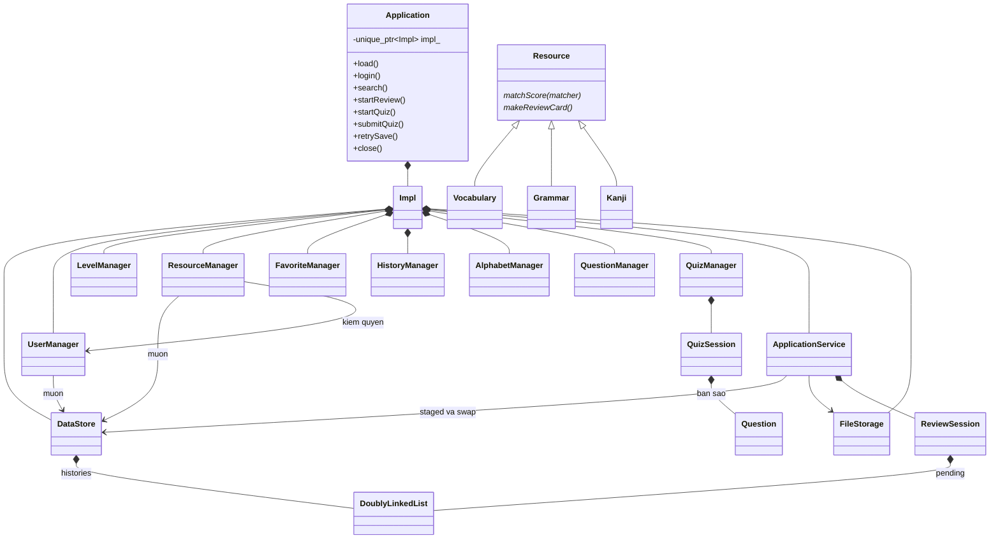
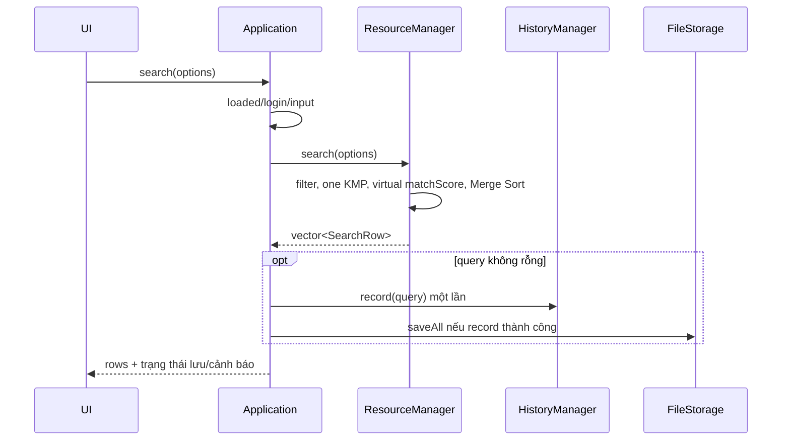
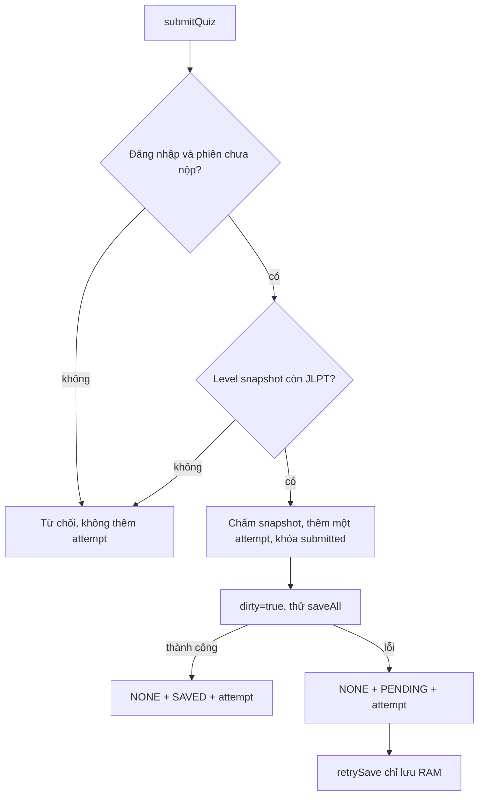

# Kiến trúc backend

## Phân chia trách nhiệm

Application là ranh giới duy nhất cho frontend: kiểm trạng thái loaded/login/quyền, nhận request không có ID tự cấp, gọi nghiệp vụ, trả snapshot đã lọc và tự thử lưu. Impl đặt trong Application.cpp để header frontend không lộ DataStore/manager. Đây là một đối tượng implementation, không phải DI container hoặc repository framework.

Manager giữ luật nhóm dữ liệu và tiếp tục kiểm quyền dù bị gọi trực tiếp từ test nội bộ. ApplicationService điều phối xóa Resource/Favorite staged, import staged, tạo review từ favorites và load/save. Không có BaseManager, singleton, event bus hoặc transaction framework. FileStorage chỉ biết TXT và tính hợp lệ kho, không điều khiển UI.

Các manager còn lại cũng mượn DataStore và UserManager, không sở hữu kho thứ hai. Quan hệ trong sơ đồ rút gọn theo vai trò, tên method thực tế xem header.

## Ownership và lifetime

| Quan hệ | Vòng đời thật và ý nghĩa |
|---|---|
| Application → Impl → DataStore/managers/storage | Composition: hủy Application thì các member được hủy; thứ tự khai báo tạo data trước manager |
| DataStore → vector entity và DLL histories | Composition, entity theo giá trị; không có delete thủ công cho Resource |
| DoublyLinkedList → Node → T | Composition: mỗi list sở hữu node riêng, Node.data khởi tạo trực tiếp, không đòi default constructor |
| Manager → DataStore&/UserManager& | Association không sở hữu, tham chiếu sống lâu cùng Impl |
| Favorite → UserId/ResourceId; Resource → LevelId | Association qua danh tính, không giữ pointer vào vector |
| Search view vector<const Resource*> | Aggregation mượn tạm trong một query; hủy view không hủy entity |
| matchScore(const KmpMatcher&) | Dependency trong lời gọi, không giữ matcher sau query |
| ReviewSession/QuizSession → nội dung phiên | Composition của các bản sao, không bị vector nguồn realloc/xóa làm dangling |

Resource trừu tượng có destructor virtual, copy/assignment protected để ngăn gán riêng phần lớp cha và slicing. Ba lớp con final có copy theo giá trị. Lời gọi virtual thật ở ResourceManager::search và ApplicationService::startReview; không phải chỉ có chữ virtual trong header.

Entity string/số/enum/ID dùng quy tắc mặc định cho copy/destructor. Copy entity giữ ID, không sinh ID mới. DoublyLinkedList tự quản lý destructor/deep copy/copy-and-swap; copy lỗi clear chuỗi node đã dựng rồi ném lại. Không viết move riêng: rvalue có thể dùng copy an toàn; swap hai list O(1). Application cấm copy/move để tránh manager trỏ sang kho của object khác. Session copy giữ nội dung độc lập; UI chỉ nhận view theo giá trị đã bỏ trường nhạy cảm.

## Luồng chính

Xóa Resource: admin/tồn tại/không Question → copy DataStore staged → xóa Resource và Favorite trên staged → rebuild/validate → swap → dirty → save. Import cũng kiểm gói riêng, kiểm xung đột ID/nội dung Level, ghép staged và swap một lần. Load dùng staged riêng trong FileStorage; failure không đổi kho. Save chỉ nguyên tử theo khả năng replace của từng file, không nguyên tử cho cả 11 file.

Login giữ optional<UserId>; epoch thay đổi mỗi login/logout. Review/quiz chỉ được trả khi epoch trùng. Application còn reset trực tiếp các phiên khi đổi tài khoản/load. Snapshot UI cũ có thể vẫn tồn tại trong bộ nhớ UI, nhưng không thể dùng nó làm capability để sửa phiên cũ hoặc truy cập dữ liệu user khác.

## CTDL, thuật toán và độ phức tạp

N là số Resource, I là tổng entity có chỉ mục, H/F/Q là số history/favorite/question, E là số câu đủ điều kiện, k số kết quả/câu chọn, m độ dài query và L tổng byte các trường được quét. Hash/so/copy string còn phụ thuộc độ dài string.

| Thao tác | Chi phí và lý do |
|---|---|
| Lookup ID | Trung bình O(1), xấu nhất O(N) phép tra băm; index lưu vị trí số |
| Rebuild index | Trung bình O(I), phát hiện trùng; vector erase làm dịch vị trí nên phải rebuild |
| CRUD có rebuild | Có chi phí rebuild và/hoặc dịch vector, không phải O(1) toàn thao tác |
| Search nội dung | O(m+L+f) cho KMP trên f trường, cộng O(N) filter và O(k log k) sort |
| Merge Sort | O(k log k) so sánh, O(k) buffer copy, O(log k) stack; khi tương đương lấy trái trước |
| Favorite add/list | O(F) quét cặp/user; không có cache phụ dư thừa |
| History listNewest/clear | O(H), duyệt ngược hoặc eraseIf; không sort timestamp mỗi lượt |
| Review mỗi bước | O(1) thao tác node, cộng copy thẻ; tạo review còn quét F và tra ID |
| Start quiz | O(Q) lọc, O(E) shuffle, O(k) copy; một engine, không seed từng câu |
| Submit | O(k) chấm, cấp AttemptId còn quét attempts, rồi save toàn kho |
| Staged import/xóa | Copy O(kích thước kho), rebuild/validate và ghép/xóa; quan hệ Favorite/Question còn phải quét |
| Save | Rebuild/kiểm bản copy, serialize toàn kho; thời gian/bộ nhớ theo tổng dữ liệu, không chỉ bản ghi vừa sửa |

List invariant: rỗng thì head/tail null và count=0; không rỗng head.prev/tail.next null; next/prev đối xứng; count bằng node thật. Node private, không lộ ownership ra API. Callbacks forEach không được sửa cấu trúc cùng list; xóa khi duyệt dùng eraseIf.

KMP xử lý byte UTF-8 nguyên vẹn, không tự chuyển kana/romaji hoặc bỏ dấu. MatchScore lấy max: exact term 4, prefix 3, substring term/trường phụ 2, meaning 1, else 0. Trường phụ: vocabulary.reading; grammar.structure/usage; kanji.onyomi/kunyomi. Không search example/note. Mặc định score giảm, level.order tăng, số ID tăng; giảm chỉ đảo tiêu chí chính, tie ID vẫn tăng.
