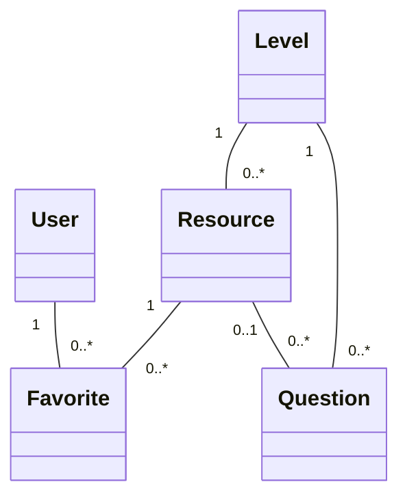

# PBL2 — BẢN CHỐT THIẾT KẾ BACKEND 3.0

**Đề tài:** Xây dựng hệ thống quản lý và tra cứu kho học liệu tiếng Nhật.
**Ngày cập nhật:** 30/10/2026.
**Nền tảng:** C++17, lưu TXT, vận dụng Kỹ thuật lập trình, Cấu trúc dữ liệu và Lập trình hướng đối tượng.
**Phạm vi tài liệu:** Mô hình dữ liệu, quan hệ đối tượng, cấu trúc dữ liệu, thuật toán, nghiệp vụ, lưu trữ và kiểm thử. Không thiết kế UI/UX.
**Trạng thái:** Thiết kế đích để nhóm triển khai; chưa phải mã nguồn đã chạy hay kết quả kiểm toán repository.

## 1. Điều chỉnh cách hiểu và căn cứ thiết kế

Bản 2.0 đã hạ mức kỹ thuật quá thấp: gần như mọi tập dữ liệu đều dùng linked list, tìm ID bằng quét tuyến tính, sắp xếp bằng Selection Sort và loại bỏ bảng băm. Những lựa chọn này không phản ánh đầy đủ năng lực đã học của nhóm.

Bản 3.0 chọn các kiến thức có nhiệm vụ cụ thể: một cấu trúc dữ liệu tự cài thật chắc; thuật toán tìm kiếm và sắp xếp đủ chiều sâu; OOP thể hiện qua hành vi, quyền sở hữu và các ràng buộc liên kết. Không đặt giới hạn “chỉ dùng kiến thức nhập môn”, cũng không biến việc dùng hết cú pháp thành mục tiêu.

Căn cứ sử dụng:

- Bản thiết kế 2.0 và ảnh ER đã cung cấp: xác định phạm vi sản phẩm, các loại học liệu và định dạng TXT đã dự kiến.
- `Quy định.md`: bài toán quản lý, hai thành viên, báo cáo có UML/sơ đồ khối, cả hai phải hiểu code và demo 5–7 phút.
- Thông tin mới của người dùng ngày 30/10/2026: đã học các thuật toán sắp xếp, linked list đôi, stack/hash và đầy đủ nội dung OOP; được dùng thư viện như `vector`, chỉ cần tối thiểu một cấu trúc dữ liệu tự cài. **Thông tin này thay thế ràng buộc cấm container thư viện trong bản ghi quy định cũ.**
- `ObjectRelation.pdf`, đặc biệt trang PDF 15–24: ví dụ aggregation dùng `vector<Teacher*>`; trang 31–37: liên kết gián tiếp qua ID; trang 38: phân biệt value container và reference container.
- `Class_Object.pdf`, `DaNangHoa.pdf`, `KeThua_DaHinh.pdf`, `Template.pdf`, `Exception.pdf`, `OOP_C++.pdf`, `ExternC++.pdf`: đối chiếu các nhóm kiến thức, không suy diễn rằng mọi cú pháp trong slide đều phải xuất hiện trong đồ án.

Chưa có tài liệu xác nhận giảng viên bắt buộc “mỗi model có một manager”. Đây được xem là gợi ý tổ chức code, không phải một yêu cầu đã kiểm chứng. Thiết kế dưới đây vẫn phân công rõ lớp nào quản lý model nào.

## 2. Các quyết định chốt

| Hạng mục | Phương án 3.0 | Lý do |
|---|---|---|
| Kho dữ liệu chính | Các `std::vector<T>` chứa entity theo giá trị | Duyệt, sao chép, truy cập vị trí thuận tiện; tránh cấp phát từng entity thủ công |
| CTDL tự cài | `DoublyLinkedList<T>` | Dùng thật trong lịch sử và hàng đợi ôn, có duyệt hai chiều, xóa và deep copy |
| Tra cứu ID | `std::unordered_map<string, Location>` | Dùng kiến thức bảng băm để tra cứu trực tiếp; không tự cài thêm bảng băm |
| Sắp xếp | Merge Sort tự cài trên `vector` kết quả | O(k log k), ổn định, dùng comparator cho nhiều tiêu chí |
| Tìm chuỗi con | KMP tự cài | Xử lý mẫu lặp có hệ thống; dùng lại bảng LPS cho cùng truy vấn |
| Xếp hạng tìm kiếm | Trùng nguyên mục → tiền tố → chứa ở mục/cách đọc → chứa ở nghĩa | Quy tắc xác định, dễ giải thích và kiểm thử |
| Chọn câu luyện | `std::shuffle` trên danh sách câu hợp lệ, lấy k phần tử | Ngẫu nhiên không lặp; không cần viết lại mọi thuật toán thư viện |
| Kế thừa | `Resource` trừu tượng; `Vocabulary`, `Grammar`, `Kanji` kế thừa public | Ba loại là học liệu và có hành vi dùng chung qua đa hình |
| Quan hệ lâu dài | Lưu ID của đối tượng liên quan | Tránh con trỏ hỏng khi vector tăng dung lượng hoặc xóa phần tử |
| View đa hình tạm | `vector<const Resource*>` chỉ sống trong một truy vấn | Minh họa tập hợp tham chiếu không sở hữu, không nhân đôi học liệu |
| Manager | Chia theo nhóm trách nhiệm; ba loại học liệu chung `ResourceManager` | Tránh trùng logic cấp ID, tìm kiếm và xóa liên kết |
| Điều phối liên module | Một `ApplicationService` nhỏ | Xử lý xóa học liệu, nhập gói, bắt đầu phiên ôn và lưu thay đổi |
| Singleton | Không dùng cho domain hoặc manager | Không giúp sinh getter/setter; không cần trạng thái toàn cục |
| Lưu TXT | Giữ 8 file cũ và 3 file đã dự kiến; chỉ thay cách ghép đối tượng trong RAM | Hạn chế thay định dạng và dữ liệu đã chuẩn bị |
| Kiểm tra dữ liệu | Giá trị hợp lệ + khóa duy nhất + liên kết hợp lệ | Tập trung tính đúng nghiệp vụ, không triển khai xử lý ngôn ngữ phức tạp |

Đây là phương án nộp chính. Không có hai kiến trúc song song để nhóm phải tự chọn lại.

## 3. Phạm vi chức năng và điểm nổi bật

### 3.1. Chức năng hoàn chỉnh

| Nhóm | Chức năng |
|---|---|
| Tài khoản | Đăng nhập/đăng xuất; phân quyền; admin tạo, khóa/mở khóa, đặt lại mật khẩu demo |
| Học liệu | Thêm/sửa/xóa Vocabulary, Grammar, Kanji; xem chi tiết; quản lý cấp độ |
| Tra cứu | Tìm ID chính xác; tìm nội dung; lọc theo loại/cấp độ; xếp hạng và sắp xếp |
| Cá nhân | Yêu thích riêng; lịch sử tìm kiếm riêng; tìm lại; xóa lịch sử của mình |
| Ôn tập | Tạo phiên từ yêu thích; xem đáp án; mục chưa nhớ được đưa cuối hàng đợi |
| Bảng chữ cái | Tra cứu Hiragana/Katakana, lọc nhóm âm; admin quản lý nội dung |
| Luyện câu hỏi | Quản lý ngân hàng bốn lựa chọn; chọn ngẫu nhiên theo cấp độ; chấm bài; luyện lại câu sai trong phiên; lưu lịch sử điểm |
| Quản trị dữ liệu | Thống kê theo loại/cấp độ; nhập gói chỉ thêm mới; xuất gói học liệu |
| Lưu trữ | Nạp toàn bộ hoặc báo lỗi; ghi TXT có kiểm tra; mở lại giữ đúng dữ liệu đã lưu |

Bảng chữ cái và câu hỏi vẫn thuộc phạm vi vì mục tiêu đề tài trong quy định đã nêu chúng. Không thêm đăng ký qua email, mạng, cơ sở dữ liệu SQL hoặc AI.

### 3.2. Ba phần tạo chiều sâu

1. **Tra cứu có thuật toán:** lọc, KMP, xếp hạng theo vị trí khớp và Merge Sort; tìm ID có chỉ mục băm riêng.
2. **Quản lý có toàn vẹn dữ liệu:** một bản học liệu chính; không trùng yêu thích; không xóa đối tượng đang được câu hỏi tham chiếu; sửa cấp độ không làm hỏng liên kết.
3. **Dùng kho học liệu để học thật:** yêu thích → ôn lại; ngân hàng câu hỏi → bài ngẫu nhiên → điểm → luyện lại câu sai trong phiên. Các chức năng dùng lại dữ liệu và hành vi đã có.

Không cần bổ sung thêm nhiều tính năng để chứng minh năng lực. Chất lượng thể hiện ở tính nhất quán, lời giải thuật toán và khả năng giải thích quyết định thiết kế.

## 4. Tổ chức backend

| Thành phần | Trách nhiệm |
|---|---|
| `domain/` | Các entity, kiểu ID, enum và đối tượng phiên; quy tắc cục bộ của từng đối tượng |
| `dsa/` | `DoublyLinkedList<T>`; không biết tài khoản, học liệu hoặc file |
| `algorithms/` | Merge Sort, KMP và comparator; không truy cập kho dữ liệu |
| `DataStore` | Sở hữu dữ liệu trong RAM, chỉ mục suy ra và thao tác `rebuildIndexes()`/`swap()` |
| `managers/` | Các thao tác nghiệp vụ của từng nhóm dữ liệu |
| `ApplicationService` | Điều phối thao tác liên nhiều manager và yêu cầu lưu |
| `FileStorage` | Đọc, parse, ghép bản ghi, kiểm tra và ghi TXT |

`Application` tạo `DataStore` trước, sau đó tạo `UserManager`, các manager còn lại, `FileStorage` và `ApplicationService`. Các manager giữ tham chiếu đến cùng `DataStore`; không tự tạo kho dữ liệu riêng. Những manager cần kiểm quyền nhận `const UserManager&`.

`DataStore` có thể là struct nội bộ chứa các container để code ngắn và dễ đọc. Nó không được truyền cho lớp gọi nghiệp vụ bên ngoài. Các entity vẫn private dữ liệu; kết quả truy vấn không cho phép sửa trực tiếp kho. Khi cần đóng gói chặt hơn, có thể chuyển thành class mà không thay các luật nghiệp vụ, nhưng đó không phải một kiến trúc thứ hai bắt buộc.

Không làm một lớp `BaseManager<T>` có CRUD tự động cho mọi model. Việc thêm User, thêm Favorite và nộp QuizAttempt có các ràng buộc khác nhau. Chỉ dùng template cho thao tác thực sự giống nhau, chẳng hạn thuật toán sắp xếp hoặc container.

### 4.1. Quyền sở hữu

- `DataStore` sở hữu các entity theo giá trị trong vector và các bản ghi lịch sử trong danh sách đôi.
- Manager chỉ mượn `DataStore&`; destructor của manager không xóa kho.
- `DoublyLinkedList` sở hữu node; mỗi node sở hữu `T data` theo giá trị.
- View đa hình chỉ mượn con trỏ `const Resource*`; không gọi `delete` chúng.
- Phiên ôn và bài luyện giữ bản sao nội dung cần thiết; không giữ con trỏ tới vector gốc.
- Không có hai container cùng nhận trách nhiệm hủy một đối tượng cấp phát động.

## 5. Mô hình domain

### 5.1. Gộp thông tin chung vào Resource

Trong RAM, `Resource` chứa `id`, `levelId`, `meaning`. Ba thuộc tính này đều có ý nghĩa chung với từ vựng, ngữ pháp và kanji. Lớp con giữ phần nội dung riêng.

| Lớp | Dữ liệu chính | Hành vi |
|---|---|---|
| `EntityId<Prefix>` | Chuỗi ID hợp lệ, phần số có độ dài thay đổi | `isValid`, getter chuỗi `getId`, `number()` trả `std::uint64_t`, `==`, `!=` |
| `Resource` | ResourceId, LevelId, meaning | Getter chung; hành vi ảo cho loại, thuật ngữ, tìm kiếm và tạo thẻ |
| `Vocabulary final : Resource` | word, reading, PartOfSpeech, example | Tìm trong từ/cách đọc/nghĩa; tạo thẻ từ vựng |
| `Grammar final : Resource` | pattern, structure, usage, example, note | Tìm trong mẫu/cấu trúc/cách dùng/nghĩa; tạo thẻ ngữ pháp |
| `Kanji final : Resource` | character, strokeCount, onyomi, kunyomi, examples | Tìm trong chữ/cách đọc/nghĩa; tạo thẻ kanji |
| `Level` | id, category, name, order, description | Cấp độ dùng chung; không suy cấp độ từ hậu tố ID |
| `User` | id, username, password, role, status | Kiểm mật khẩu, thay trạng thái/mật khẩu qua nghiệp vụ |
| `Favorite` | id, userId, resourceId | Bản ghi quan hệ yêu thích |
| `SearchHistory` | id, userId, query, searchedAt | Lần tìm với từ khóa không rỗng |
| `AlphabetEntry` | id, script, glyph, romaji, groupName, displayOrder, note | Một mục Hiragana/Katakana |
| `Question` | id, levelId, resourceId tùy chọn, prompt, 4 options, correctOption, explanation, status | `isCorrect(answer)`; kiểm cấu trúc câu hỏi |
| `QuizAttempt` | id, userId, levelId, totalQuestions, correctAnswers, submittedAt | Kết quả tổng hợp bất biến sau nộp; tính phần trăm |

Kiểu phụ trợ: `SearchOptions`, `SearchRow`, `ReviewCard`, `ReviewSession`, `QuizSession`, `ResourceLocation`. Đây không phải các bảng cần CRUD riêng.

Với `Question.resourceId`, dùng `std::optional<ResourceId>` để biểu diễn có hoặc không liên kết. Trong TXT, cột rỗng tương ứng `std::nullopt`. Không tạo ID giả hoặc ID rỗng cho một đối tượng đang được xem là hợp lệ.

### 5.2. Giao diện Resource

Đoạn dưới là khung thiết kế, chưa phải một header đầy đủ include và definition:

```cpp
class Resource {
private:
    ResourceId id;
    LevelId levelId;
    std::string meaning;

protected:
    Resource(const ResourceId&, const LevelId&, const std::string&);
    Resource(const Resource&) = default;
    Resource& operator=(const Resource&) = default;

public:
    virtual ~Resource() = default;
    const ResourceId& getId() const;
    const LevelId& getLevelId() const;
    const std::string& getMeaning() const;

    virtual ResourceType getType() const = 0;
    virtual std::string getTerm() const = 0;
    virtual int matchScore(const KmpMatcher& matcher) const = 0;
    virtual ReviewCard makeReviewCard() const = 0;
};
```

`getId`, `getLevelId`, `getMeaning` không cần virtual vì dữ liệu đã nằm ở lớp cha. `matchScore` và `makeReviewCard` thực sự khác nhau giữa ba lớp con. Constructor của lớp con gọi constructor cha bằng initialization list.

Các lớp con được copy theo giá trị trong vector. Copy của phần lớp cha để protected giúp lớp con sao chép được, đồng thời ngăn bên ngoài gán riêng phần Resource qua tham chiếu cha. Getter chỉ trả dữ liệu đọc; không có public `setId` hoặc `setType`.

Không dùng `vector<Resource>`: lớp cha trừu tượng không thể khởi tạo theo giá trị. Không cần đổi sang container sở hữu con trỏ chỉ để thể hiện đa hình; ba vector kiểu cụ thể kết hợp view tham chiếu đã đáp ứng yêu cầu.

### 5.3. Sửa đổi có chủ đích so với constructor cũ

Constructor Vocabulary đích nhận **7 giá trị**: ID, LevelId, word, reading, meaning, PartOfSpeech, example. Grammar và Kanji nhận 8 giá trị tính cả ID/LevelId. Đây là thay đổi mô hình RAM; số cột trong file chi tiết vẫn giữ nguyên.

Khi sửa một học liệu, manager kiểm tra toàn bộ dữ liệu mới rồi tạo đối tượng cùng ID và cùng loại để thay thế đối tượng cũ. Không bắt setter cho từng trường. Có thể copy để làm bản nháp, nhưng copy không tự sinh ID mới.

Các class chỉ chứa string/số/enum/ID dùng copy constructor, assignment và destructor mặc định khi phù hợp. Không tự viết ba hàm rỗng cho từng entity chỉ để đủ hình thức. Danh sách đôi có node cấp phát động mới là nơi phải cài việc sao chép/hủy rõ ràng.

## 6. Phân biệt mô hình TXT với mô hình đối tượng

`learning_resource.txt` vẫn lưu `resource_id|resource_type|level_id`. Khi nạp, `FileStorage` đọc các dòng này thành `ResourceHeader` tạm, ghép với dòng chi tiết rồi tạo Vocabulary/Grammar/Kanji đầy đủ.

Ví dụ:

```text
learning_resource.txt: R001|VOCABULARY|L005
vocabulary.txt:        R001|学校|がっこう|trường học|NOUN|学校へ行きます。
```

Hai dòng trên tạo **một đối tượng Vocabulary** có ID R001, LevelId L005 và nội dung tương ứng. L005 phải tồn tại; ví dụ này không tự quy ước L005 luôn là N5.

Khi ghi, `FileStorage` tách một đối tượng thành một dòng danh mục và một dòng chi tiết. Trong kho đang chạy không giữ thêm CatalogEntry có thể bị sửa độc lập với Resource. ResourceType được lấy từ `getType()` của đối tượng.

Kiểm tra bắt buộc khi nạp:

1. Mỗi ID học liệu có đúng một header và đúng một dòng chi tiết.
2. Loại header khớp loại file chi tiết.
3. Không có cùng ID xuất hiện ở hai loại học liệu.
4. Không có chi tiết thiếu header hoặc header thiếu chi tiết.
5. Level của header tồn tại.

Quan hệ danh mục–chi tiết trên dữ liệu lưu là **1:1 với đúng một loại con**, có điều kiện loại trừ giữa Vocabulary/Grammar/Kanji. Không hiểu thành mỗi học liệu phải có đủ cả ba loại chi tiết. Trong sơ đồ lớp, Resource–Vocabulary là **kế thừa**, không vẽ thành association 1:1.

## 7. Quan hệ đối tượng và số lượng liên kết

### 7.1. Quan hệ nghiệp vụ

| Quan hệ | Số lượng | Cài đặt và quy tắc |
|---|---|---|
| Level — Resource | 1 — 0..n | Mỗi Resource có đúng một LevelId; Level có thể chưa có học liệu |
| User — Favorite | 1 — 0..n | Favorite giữ UserId |
| Resource — Favorite | 1 — 0..n | Favorite giữ ResourceId |
| User — Resource qua Favorite | n — n | Cặp `(userId, resourceId)` duy nhất |
| User — SearchHistory | 1 — 0..n | History giữ UserId; chỉ truy vấn lịch sử của tài khoản hiện hành |
| Level — Question | 1 — 0..n | Mỗi Question có một cấp độ JLPT |
| Resource — Question | 0..1 — 0..n | Mỗi Question liên kết tối đa một Resource; Resource có nhiều câu hỏi |
| User — QuizAttempt | 1 — 0..n | Một tài khoản có nhiều lượt làm bài |
| Level — QuizAttempt | 1 — 0..n | Bài luyện theo đúng một cấp độ |

Không ép tạo model mới chỉ để đủ quan hệ 1:1. Trong bài này, 1:1 danh mục–chi tiết là vấn đề của biểu diễn lưu trữ; không cần tạo thêm `UserProfile` hoặc model tương tự khi nghiệp vụ chưa cần.



### 7.2. Các loại quan hệ OOP

| Loại | Ví dụ trong code | Điểm phải hiểu |
|---|---|---|
| Inheritance | Vocabulary/Grammar/Kanji kế thừa Resource | Quan hệ “là một”, thay thế qua giao diện cha |
| Composition | DataStore chứa vector; danh sách sở hữu node; QuizSession chứa bản sao Question | Phần chứa thuộc vòng đời đối tượng sở hữu |
| Aggregation | View tạm `vector<const Resource*>` tập hợp học liệu đã tồn tại | Hủy view không hủy học liệu; quyền sở hữu vẫn ở DataStore |
| Association | Favorite giữ UserId/ResourceId; Resource giữ LevelId | Liên kết có danh tính, không sở hữu đối tượng bên kia |
| Dependency | Hàm chấm bài nhận `const Question&`; hàm tạo kết quả nhận `const Resource&` | Dùng đối tượng trong một lời gọi, không nhất thiết giữ lại |

Một thành viên tham chiếu được giữ lâu dài, như `ResourceManager::data`, là association không sở hữu; không gọi tất cả tham số/thành viên tham chiếu là dependency. Không quyết định aggregation/composition chỉ bằng việc nhìn thấy dấu `*` hoặc `vector`; phải xét vòng đời và trách nhiệm hủy.

### 7.3. Vì sao không lưu quan hệ lâu dài bằng vector con trỏ?

`vector<Resource*>` có thể biểu diễn tập hợp đối tượng như ví dụ Teacher trong slide, nhưng không tự giải quyết vòng đời. Các học liệu của bài này đang được lưu theo giá trị trong vector. Khi vector cấp phát lại hoặc xóa dịch phần tử, con trỏ đã lấy có thể mất hiệu lực.

Vì vậy, Favorite/Question lưu ID. Khi cần dữ liệu thì tra qua chỉ mục. `vector<const Resource*>` chỉ được tạo và tiêu thụ trong một hàm tìm kiếm/đọc, trong khoảng đó không sửa kho, rồi bị hủy. Kết quả trả ra là `vector<SearchRow>` theo giá trị. Không giữ con trỏ trong chỉ mục, phiên học hoặc kết quả dùng lâu dài.

## 8. Manager: tách theo trách nhiệm, không theo số lượng class

| Manager | Model/đối tượng phụ trách | Nghiệp vụ chính |
|---|---|---|
| `UserManager` | User, phiên đăng nhập | login/logout, create, lock/unlock, resetPassword, kiểm quyền |
| `LevelManager` | Level | create/update/remove, thứ tự cấp độ, kiểm đối tượng đang tham chiếu |
| `ResourceManager` | Vocabulary, Grammar, Kanji | add/update theo loại; lookup; search; thống kê; primitive xóa nội bộ |
| `FavoriteManager` | Favorite | add/remove/list của người hiện hành; xóa liên quan khi điều phối |
| `HistoryManager` | SearchHistory | record/list/clear của người hiện hành; duyệt lịch sử mới nhất |
| `AlphabetManager` | AlphabetEntry | CRUD và tra cứu/lọc nhóm âm |
| `QuestionManager` | Question | CRUD, active/inactive, lọc câu hợp lệ, kiểm liên kết học liệu |
| `QuizManager` | QuizSession, QuizAttempt | start/selectAnswer/submit/retryWrong; lịch sử điểm |
| `ApplicationService` | Không sở hữu thêm bảng nghiệp vụ | removeResource/importPackage/startReview; gọi lưu |

`ReviewSession` tự quản lý trạng thái phiên và danh sách thẻ. Không cần thêm `ReviewCardManager`, `SearchRowManager`, `CatalogManager`, `EntityIdManager`.

Ba loại học liệu chung ResourceManager vì có không gian ID chung, cùng luồng tìm kiếm, quy tắc xóa và quan hệ với Favorite/Question. Trong manager vẫn có hàm riêng `addVocabulary`, `updateGrammar`, `addKanji` để kiểm dữ liệu đúng loại. Không dùng một hàm nhận hàng loạt string tùy chọn cho mọi loại.

Một model không nhất thiết có đủ CRUD công khai:

- User được khóa, không xóa vật lý trong bản này.
- Favorite là thêm/bỏ liên kết; không có sửa resourceId của một yêu thích.
- SearchHistory được hệ thống ghi; không cho sửa nội dung lịch sử tùy ý.
- QuizAttempt được tạo bằng nộp bài; không cho sửa điểm qua CRUD.
- ResourceHeader chỉ là bản ghi đọc file, không có manager nghiệp vụ.

Nếu cần chia việc cho hai thành viên, có thể tách implementation ResourceManager thành các file theo loại mà vẫn giữ một lớp và một bộ quy tắc chung. Không cần thêm hệ thống kế thừa manager.

### 8.1. Singleton và getter/setter

Singleton giới hạn số instance của một class và thường cung cấp điểm truy cập toàn cục. Nó không tự tạo getter/setter, không thể hiện quan hệ 1:n và không rút ngắn việc đóng gói entity.

Ví dụ, chương trình cần hàng nghìn Vocabulary nên Vocabulary không thể là Singleton. Với ResourceManager, chỉ tạo một instance trong Application rồi truyền tham chiếu đã đủ cho nhu cầu dùng chung; không cần khóa constructor bằng mẫu Singleton. C++ Core Guidelines I.3 cũng khuyến nghị tránh Singleton vì dễ che giấu trạng thái toàn cục.

`static` vẫn có chỗ dùng rõ: `EntityId::isValid`, hằng giới hạn số câu. Không dùng biến đếm static số object để sinh ID lưu trữ, vì copy object và khởi động lại làm quy tắc đó sai.

## 9. Cấu trúc dữ liệu và chỉ mục

### 9.1. DataStore

| Dữ liệu | Container chính |
|---|---|
| vocabularies, grammars, kanjis | `vector<Vocabulary>`, `vector<Grammar>`, `vector<Kanji>` |
| levels, users, favorites | `vector<Level>`, `vector<User>`, `vector<Favorite>` |
| alphabet, questions, attempts | `vector<AlphabetEntry>`, `vector<Question>`, `vector<QuizAttempt>` |
| histories | `DoublyLinkedList<SearchHistory>` |
| hàng đợi trong ReviewSession | `DoublyLinkedList<ReviewCard>` |
| kết quả tìm kiếm, câu hỏi trong phiên | `vector<SearchRow>`, `vector<Question>` |

Không dùng danh sách liên kết cho toàn bộ kho chỉ để tăng số chỗ xuất hiện của CTDL tự cài. Vector phù hợp khi thường xuyên duyệt, tạo bản sao, truy cập theo vị trí và trả tập kết quả.

### 9.2. Chỉ mục băm

Các chỉ mục là dữ liệu suy ra trong RAM, không ghi vào TXT:

```cpp
struct ResourceLocation {
    ResourceType type;
    std::size_t index;
};
// Thành viên nội bộ của DataStore:
std::unordered_map<std::string, ResourceLocation> resourceById;
std::unordered_map<std::string, std::size_t> userById;
std::unordered_map<std::string, std::size_t> userByName;
std::unordered_map<std::string, std::size_t> levelById;
std::unordered_map<std::string, std::size_t> questionById;
```

Key dùng string từ ID hợp lệ; không cần tự định nghĩa `std::hash<EntityId<...>>`. Username được chuyển A–Z về a–z khi lập chỉ mục và đăng nhập/kiểm trùng, trong khi tên gốc có thể giữ nguyên để đọc.

Chỉ mục lưu **vị trí số**, không lưu con trỏ. `rebuildIndexes()` xóa chỉ mục cũ và xây lại từ dữ liệu gốc, phát hiện ID/username trùng. Mọi thao tác thêm/xóa trong container được lập chỉ mục hoặc đổi username phải cập nhật chỉ mục trước khi cho phép truy vấn tiếp. Quyết định chốt để dễ bảo trì: xây lại các chỉ mục sau các thao tác đó; chưa tối ưu cập nhật từng phần.

Xóa phần tử ở giữa vector làm đổi vị trí phần tử phía sau; chỉ mục số cũng sẽ sai nếu không xây lại. Đổi dung lượng vector không làm đổi chỉ số logic, nhưng vẫn làm con trỏ/tham chiếu tới phần tử có thể mất hiệu lực.

Việc thêm/xóa Favorite, History hoặc Attempt không đổi vị trí các vector được lập chỉ mục nên không bắt buộc rebuild chúng. Favorite có thể kiểm trùng cặp bằng một lượt quét; chưa cần tạo thêm một lớp cache cho mọi quan hệ.

`DataStore` được copy theo giá trị khi làm dữ liệu thử nhập/xóa nhiều bảng. Chỉ mục kiểu vị trí không trỏ về kho cũ; sau khi sửa bản copy vẫn phải rebuild. Hoán đổi dữ liệu thành công dùng `DataStore::swap`, gọi swap của từng container và danh sách đôi. Manager giữ tham chiếu tới chính object DataStore nên tiếp tục dùng kho mới; các con trỏ mượn cũ phải đã kết thúc trước swap.

## 10. DoublyLinkedList<T> tự cài

### 10.1. Cấu trúc và API

Node private chứa `T data`, `Node* prev`, `Node* next`. Danh sách có `head`, `tail`, `count`. Constructor node khởi tạo trực tiếp `data(value)` từ `const T&`; không đòi T có constructor rỗng để gán lại sau.

| Hàm | Ý nghĩa / độ phức tạp theo số node |
|---|---|
| constructor, `empty`, `size` | O(1) |
| `pushFront`, `pushBack` | O(1), chưa tính chi phí copy T |
| `front`, `back`, bản const/non-const | O(1); ném `out_of_range` khi rỗng |
| `popFront`, `popBack` trả bool | O(1); false khi rỗng; không trả con trỏ node |
| `forEach`, `forEachReverse` | O(n), duyệt node trực tiếp |
| `eraseIf(predicate)` | O(n) tìm toàn bộ phần tử; mỗi lần nối bỏ node đã biết O(1) |
| `clear`, destructor | O(n) |
| copy constructor | O(n) node và chi phí copy T; chuỗi node hoàn toàn độc lập |
| `operator=` | Copy-and-swap; bản sao độc lập, xử lý tự gán |
| `swap` | Đổi head/tail/count, O(1) |

Các hàm duyệt nhận callable; có thể dùng lambda ngắn hoặc functor có tên. Callback duyệt không được thay cấu trúc của chính danh sách đang duyệt; việc vừa duyệt vừa xóa do `eraseIf` xử lý nội bộ. Node không lộ ra ngoài; không bắt viết một bộ iterator chuẩn STL đầy đủ.

### 10.2. Invariant cần giữ

- Rỗng: head và tail cùng null, count bằng 0.
- Không rỗng: `head->prev == nullptr`, `tail->next == nullptr`.
- Nếu `p->next == q` thì `q->prev == p`.
- Một phần tử: head bằng tail, cả prev/next đều null.
- Số node khi duyệt bằng count.
- Xóa node cuối cùng đưa danh sách về trạng thái rỗng đầy đủ.

Copy constructor tạo node mới, không copy địa chỉ head/tail. Nếu việc copy T ném ngoại lệ giữa chừng, phải clear các node đã dựng rồi ném lại. `operator=` tạo bản sao tạm rồi swap; nếu tạo bản sao thất bại thì danh sách đích cũ còn nguyên. Định nghĩa template nằm trong `.h` hoặc `.tpp` được include từ `.h`.

### 10.3. Vì sao chọn danh sách đôi?

History được thêm cuối theo thứ tự ghi, xem mới nhất bằng duyệt từ tail; có thể duyệt cả hai hướng, xóa lịch sử của một tài khoản bằng `eraseIf`. Không sort theo thời gian mỗi lần đọc; file history được ghi theo thứ tự danh sách và nạp lại theo thứ tự dòng.

ReviewSession dùng `pushBack` và `popFront` như hàng đợi FIFO; không cần tự tạo thêm một CTDL Queue với chuỗi node thứ hai. Riêng FIFO có thể dùng linked list đơn head/tail; ưu điểm của danh sách đôi ở dự án là dùng lại container cho lịch sử và thao tác hai đầu, không phải FIFO bắt buộc cần prev.

Nếu đã có linked list đơn, giữ phần ý tưởng đúng về sở hữu/copy và nâng thành đôi bằng các invariant trên. Không giả định chỉ thêm một biến prev là hoàn tất. Việc sửa code thực tế cần xem implementation hiện có; tài liệu này chưa xác nhận code nào đang nằm trong repo.

## 11. Tìm kiếm và sắp xếp

### 11.1. Luồng tìm kiếm thống nhất

1. Chuẩn bị SearchOptions: từ khóa, chế độ ID/nội dung, bộ lọc loại/cấp độ, tiêu chí sort.
2. Chế độ ID: tìm chính xác qua `resourceById`; áp dụng thêm bộ lọc nếu có.
3. Chế độ nội dung: dựng một `KmpMatcher` cho truy vấn, tạo view mượn của các Resource đúng bộ lọc.
4. Gọi `resource->matchScore(matcher)` qua con trỏ lớp cha; lớp con quyết định các trường của nó.
5. Tạo SearchRow theo giá trị: ID, loại, thuật ngữ, nghĩa, cấp độ, order và score.
6. Merge Sort tập kết quả theo comparator đã chọn; hủy view mượn trước khi kết thúc lời gọi.
7. Nếu từ khóa không rỗng, ghi một SearchHistory cho lần tìm đã thực hiện.

Việc ghi lịch sử xảy ra sau khi đã dùng xong view. Nếu lưu lịch sử ra file thất bại, kết quả tra cứu vẫn có giá trị; kết quả thao tác phải nói riêng trạng thái lưu.

Từ khóa rỗng nghĩa là liệt kê theo bộ lọc, không chạy KMP và không ghi history. Không dùng chỉ mục băm ID để tuyên bố tìm chuỗi con trong nội dung cũng O(1).

### 11.2. Ngữ nghĩa khớp và thứ tự mặc định

| Điểm | Điều kiện |
|---:|---|
| 4 | Từ khóa bằng toàn bộ thuật ngữ chính: word/pattern/character |
| 3 | Từ khóa là tiền tố của thuật ngữ chính |
| 2 | Từ khóa nằm trong thuật ngữ hoặc trường phụ được tìm |
| 1 | Từ khóa nằm trong meaning |
| 0 | Không khớp |

Trường phụ: Vocabulary.reading; Grammar.structure/usage; Kanji.onyomi/kunyomi. Nếu khớp nhiều trường lấy điểm cao nhất, không cộng tùy tiện theo số lần xuất hiện. Example/note không nằm trong tìm kiếm chính để giữ ý nghĩa kết quả rõ ràng.

Mặc định: score giảm, Level.order tăng, phần số ResourceId tăng. Các kiểu sort khác: ID tăng; cấp độ tăng/giảm rồi ID; thuật ngữ theo thứ tự `std::string` rồi ID. Chỉ đảo tiêu chí chính khi chọn giảm; tiêu chí phụ vẫn được quy định nhất quán.

Chuỗi được tìm theo nội dung đã lưu; có thể bỏ phân biệt hoa ASCII. Không cam kết bỏ dấu, tự chuyển romaji/kana hoặc thứ tự từ điển tiếng Nhật. KMP làm việc theo byte và không cần tự giải mã ký tự để tìm đúng một chuỗi nhập nguyên vẹn. Không đưa xử lý chuẩn hóa ngôn ngữ vào phạm vi lập trình.

### 11.3. KMP

`KmpMatcher` chứa pattern đã chuẩn bị và `vector<int> lps`. Xây LPS một lần O(m); `findFirst(text)` trả vị trí đầu tiên hoặc trạng thái không tìm thấy. Các hàm so nguyên chuỗi/tiền tố dùng vị trí khớp và độ dài chuỗi đã chuẩn bị.

Với bảng LPS đã có, một lần quét text tốn O(độ dài text). Nếu có f trường và tổng độ dài L, cả truy vấn tốn O(m + L + f) cho xây LPS và so khớp, chưa tính lọc/tạo kết quả/sắp xếp. Hạng f tính cả chi phí gọi và kiểm tra trường rỗng. Không cộng lại O(m) tiền xử lý cho từng trường. Helper chuyển hoa ASCII, nếu dùng, thêm một lượt theo độ dài văn bản và không thay bậc độ phức tạp này.

KMP được chọn như một thuật toán bổ sung phù hợp tra cứu; tài liệu không khẳng định môn học của nhóm đã bắt buộc dạy KMP. Tính đúng được kiểm bằng chuỗi có mẫu lặp, khớp đầu/cuối, không khớp và văn bản Nhật/Việt nguyên vẹn.

### 11.4. Merge Sort

API dự kiến:

```cpp
template<class T, class Compare>
void mergeSort(std::vector<T>& values, Compare less);
```

Tách đoạn, sắp hai nửa, trộn bằng buffer phụ. Khi hai phần tử tương đương theo comparator, lấy bên trái trước để giữ ổn định. Comparator phải là thứ tự nhất quán; không dùng `<=` thay cho `less`.

Chi phí O(k log k) lần so sánh, O(k) vùng phụ, O(log k) stack đệ quy; chi phí so/copy chuỗi phụ thuộc độ dài chuỗi. Buffer có thể khởi tạo bằng một bản copy vector để không ép mọi kiểu T có constructor rỗng.

Chọn Merge Sort vì worst-case và tính ổn định dễ chứng minh. Quick Sort cũng là kiến thức phù hợp, nhưng không cần cài cả hai cho cùng một chức năng. Không lập luận rằng Quick Sort luôn O(k log k); bản thông thường có trường hợp O(k²).

### 11.5. Độ phức tạp phải nói đúng

| Thao tác | Chi phí dự kiến |
|---|---|
| Tìm Resource theo ID | Trung bình O(1) phép tra băm, worst-case O(N); còn chi phí hash/so chuỗi ID |
| Xây lại chỉ mục | Trung bình tuyến tính theo số bản ghi được lập chỉ mục |
| Duyệt/lọc học liệu | O(N) kiểm tra đơn giản, cộng chi phí khớp nội dung |
| Sort k kết quả | O(k log k) lần so sánh |
| Thêm/xóa có rebuild chỉ mục | Không quảng cáo là O(1); có chi phí rebuild và xóa dịch vector |
| Kiểm trùng Favorite | O(F), với F là số yêu thích toàn kho ở thiết kế hiện tại |
| Lịch sử của một tài khoản | O(H) lọc trên lịch sử chung, không phải O(số dòng trả về) |
| Ôn: lấy đầu/đưa lại cuối | O(1) thao tác node, cộng chi phí copy thẻ |
| Tạo bài luyện | O(Q) lọc, O(E) shuffle E câu hợp lệ, O(k) copy câu đã chọn |
| Nộp bài k câu | O(k) chấm, cộng thêm bản ghi kết quả và lưu TXT |

N là số học liệu, F/H/Q là số Favorite/History/Question. Ghi toàn bộ TXT có chi phí theo tổng dung lượng dữ liệu; chỉ mục làm tra cứu nhanh hơn, không làm toàn bộ chương trình có chi phí O(1).

## 12. Quy tắc nghiệp vụ và toàn vẹn dữ liệu

### 12.1. Tài khoản và quyền

- Role là enum ADMIN/LEARNER; status ACTIVE/LOCKED.
- Phiên đăng nhập giữ `optional<UserId>`, không giữ `User*` trỏ vào vector.
- Vai trò lấy từ tài khoản trong kho; không nhận role do lời gọi nghiệp vụ tự khai báo.
- Các entry point thay đổi dữ liệu quản trị kiểm quyền ở manager/service.
- Không khóa tài khoản hiện hành, không khóa admin ACTIVE cuối cùng.
- Tài khoản chỉ khóa, không xóa vật lý; giữ được chủ sở hữu history/attempt/favorite.
- Chức năng cá nhân dùng UserId hiện hành; không nhận một userId bất kỳ rồi coi đó là chủ sở hữu hợp lệ.
- Đăng xuất kết thúc các phiên ôn/bài chưa nộp để tài khoản sau không dùng lại dữ liệu phiên trước.

### 12.2. Quy tắc thêm/sửa/xóa

| Đối tượng/thao tác | Quy tắc |
|---|---|
| Thêm Resource | ID duy nhất trong cả ba loại; Level tồn tại; dữ liệu đúng loại |
| Sửa Resource | Giữ ID và loại; thay nội dung bằng đối tượng mới hợp lệ |
| Đổi cấp độ Resource | Nếu có Question liên kết mà cấp độ mới khác Question.levelId thì từ chối |
| Xóa Resource | Nếu bất kỳ Question còn liên kết thì chặn; nếu không, xóa Resource và toàn bộ Favorite của nó |
| Thêm Favorite | User và Resource tồn tại; cặp user/resource chưa có |
| Bỏ Favorite | Chỉ bỏ bản ghi thuộc người hiện hành; không xóa User/Resource |
| Thêm/sửa Question | Level thuộc category JLPT; nếu liên kết Resource, Resource tồn tại và cùng Level |
| Question INACTIVE | Không chọn cho bài mới nhưng vẫn là tham chiếu khi kiểm xóa Resource |
| Xóa Question | Cho phép; phiên đang giữ bản sao vẫn có nội dung; điểm bài đã nộp không tính lại |
| Xóa Level | Chặn nếu Resource, Question hoặc QuizAttempt còn dùng |
| Đổi category Level | Chặn nếu có Question hoặc QuizAttempt dùng mà thay đổi làm mất category JLPT |
| Sửa tên/order Level | Cho phép sau kiểm trùng; không thay ID hoặc tự chuyển các tham chiếu |
| Nộp bài | Chỉ tạo một QuizAttempt; số đúng được hệ thống tính, không nhận làm đầu vào tin cậy |

Không bắt giữ mọi trạng thái cũ bằng cơ chế undo. Những quy tắc trên đủ để sản phẩm không có liên kết mồ côi trong phạm vi đã chọn.

### 12.3. Xóa học liệu liên nhiều bảng

`ApplicationService::removeResource(id, error)` là entry point duy nhất cho xóa học liệu. `ResourceManager` không công khai hàm xóa bỏ qua quan hệ. Primitive như `eraseUnchecked` để private và chỉ cấp quyền cho ApplicationService khi cần.

Trình tự:

1. Kiểm quyền admin, tồn tại học liệu, không có Question tham chiếu.
2. Tạo `DataStore staged = data` để xử lý thao tác nhiều bảng.
3. Helper nội bộ xóa đúng học liệu trong staged và Favorite liên quan.
4. Rebuild chỉ mục, kiểm invariant liên quan của staged.
5. `data.swap(staged)` khi đã hợp lệ; đánh dấu dirty và yêu cầu lưu.

Helper nhận rõ kho đích staged; không gọi nhầm manager đang giữ tham chiếu tới kho thật rồi cho rằng đã thao tác trên bản sao. Các CRUD đơn bảng đã kiểm đủ điều kiện không cần copy toàn DataStore. Không dựng framework transaction tổng quát.

Việc swap là điểm chấp nhận thay đổi trong RAM. Nó không tự đảm bảo cả 11 file trên đĩa được ghi nguyên tử.

## 13. Phiên ôn và bài luyện

### 13.1. Phiên ôn từ yêu thích

ApplicationService lấy Favorite của người hiện hành, tra Resource bằng ID, gọi đa hình `makeReviewCard()` rồi đưa bản sao vào ReviewSession. Một Resource tạo một thẻ trong phiên.

ReviewSession chứa danh sách pending, thẻ current tùy chọn, cờ đã xem đáp án, tổng thẻ ban đầu và số lượt đánh giá. Hành vi:

- Bắt đầu: lấy đầu pending làm current; chưa cho chấm nhớ/chưa nhớ trước khi xem đáp án.
- Đã nhớ: bỏ current, lấy thẻ kế tiếp.
- Chưa nhớ: pushBack bản sao current, rồi lấy thẻ tiếp theo.
- Hoàn thành khi không có current và pending rỗng.
- Dừng: kết thúc phiên, báo số thẻ còn lại gồm cả current.

Luôn có thao tác kết thúc phiên; người học có thể đánh dấu chưa nhớ mãi. “Đã nhớ” là tự đánh giá, không phải kết quả suy luận năng lực. Phiên chưa xong không lưu dở vào TXT.

### 13.2. Bài luyện câu hỏi

1. Chọn Level JLPT và số câu k, chính sách 1–50; phải có ít nhất k câu ACTIVE khác ID.
2. Tạo vector chỉ số/ID của các câu hợp lệ, `std::shuffle` bằng một engine `std::mt19937`, lấy k câu đầu.
3. Copy k Question vào QuizSession; tạo `vector<char> answers(k, '-')`, ký hiệu `-` là chưa trả lời. Không đổi thứ tự A–D trong phương án này.
4. Chọn/đổi đáp án theo vị trí hợp lệ; câu không chọn tính sai.
5. Nộp: chấm từ bản sao câu hỏi, tạo một QuizAttempt và khóa trạng thái nộp.
6. Thử ghi file. Nếu ghi lỗi, giữ attempt trong RAM và retry save; không gọi submit lần nữa để tạo kết quả trùng.
7. Luyện lại câu sai: tạo phiên mới từ các bản sao câu sai, reset đáp án; lượt nộp mới là một attempt mới. Nếu không có câu sai thì không tạo phiên rỗng.

`QuizManager::start` có thể nhận engine qua tham chiếu để kiểm thử bằng seed cố định. Không seed lại mỗi lần rút một câu. Chọn ngẫu nhiên không đồng nghĩa đề JLPT chuẩn hóa; bộ câu hỏi là dữ liệu do nhóm chuẩn bị.

**Giới hạn lưu trữ chốt:** QuizAttempt lưu điểm tổng hợp, không lưu từng đáp án. Xem lời giải/luyện lại câu sai thực hiện trong phiên kết quả hiện tại. Sau restart chỉ xem lịch sử điểm. Không tuyên bố xem lại chi tiết bài cũ khi TXT chưa có dữ liệu đó.

## 14. Hợp đồng TXT

### 14.1. Giữ nguyên các file đã dự kiến

Mỗi dòng là một bản ghi, cột ngăn bằng `|`, không header. Trường tùy chọn rỗng vẫn giữ cột. Không cho dữ liệu trường chứa `|`, CR/LF hoặc NUL. Dấu `;` nếu có là nội dung, không tự coi là một cột mới.

| File | Thứ tự trường | Số cột |
|---|---|---:|
| learning_resource.txt | resource_id, resource_type, level_id | 3 |
| vocabulary.txt | id, word, reading, meaning, type, example | 6 |
| grammar.txt | id, pattern, meaning, structure, use, example, note | 7 |
| kanji.txt | id, character, meaning, stroke_count, onyomi, kunyomi, examples | 7 |
| resource_levels.txt | id, category, name, order, description | 5 |
| user.txt | user_id, username, password, role, status | 5 |
| favorites.txt | favorite_id, user_id, resource_id | 3 |
| search_history.txt | history_id, user_id, query, searched_at | 4 |
| alphabet.txt | alphabet_id, script, glyph, romaji, group_name, display_order, note | 7 |
| question.txt | question_id, level_id, resource_id, prompt, option_a, option_b, option_c, option_d, correct_option, explanation, status | 11 |
| quiz_attempt.txt | attempt_id, user_id, level_id, total_questions, correct_answers, submitted_at | 6 |

Token: ResourceType `VOCABULARY/GRAMMAR/KANJI`; UserRole `ADMIN/LEARNER`; UserStatus `ACTIVE/LOCKED`; QuestionStatus `ACTIVE/INACTIVE`; Script `HIRAGANA/KATAKANA`. PartOfSpeech giữ `NOUN/VERB/I_ADJ/NA_ADJ/ADV/OTHER`. Không tự chuyển token không biết thành một giá trị mặc định hợp lệ.

Username được kiểm bằng ASCII như bản trước. Password theo schema hiện có chỉ dùng cho tài khoản demo cục bộ; không xuất password trong gói học liệu hoặc kết quả truy vấn tài khoản. FileStorage có thể được cấp friend có phạm vi rõ để ghi User, thay vì tạo getter mật khẩu công khai cho mọi nơi.

### 14.2. ID

Giữ `EntityId<Prefix>` và các alias R/U/L/F/H/A/Q/T. **ID gồm tiền tố và một số nguyên dương có độ dài thay đổi; không giới hạn ở 999, 100000 hoặc 999999.** Ví dụ dãy ID hợp lệ:

```text
R001 → R002 → … → R999 → R1000 → … → R100000 → R100001 → … → R1000000 → …
```

Ba chữ số là **độ rộng tối thiểu để trình bày**, không phải độ dài tối đa. Số nhỏ hơn 100 được thêm số 0 phía trước cho đủ ba chữ số; từ 100 trở lên giữ toàn bộ chữ số. Do đó R001, R999, R1000, R100000 và R1000000 đều hợp lệ; R000, R01 và R0001 không đúng định dạng chuẩn. ID cũ như R001 được giữ nguyên, không cần đánh số lại.

Lưu ID dưới dạng `std::string`; `number()` trả phần số bằng `std::uint64_t` trong `<cstdint>`. Không đặt trần nghiệp vụ ba hoặc sáu chữ số. Giới hạn kỹ thuật là miền của kiểu số này: 1 đến 18.446.744.073.709.551.615; không gọi đó là vô hạn. `isValid` đọc toàn bộ phần sau tiền tố, kiểm chữ số/định dạng và phát hiện tràn kiểu; không lấy cố định ba ký tự hoặc parse qua `int` trước.

Sinh ID bằng max phần số hiện có + 1 trong từng nhóm, kiểm tra chưa đạt giới hạn `std::uint64_t` trước khi cộng; nếu hết miền thì báo không thể cấp ID mới, không quay về 0. Học liệu lấy max chung của cả Vocabulary/Grammar/Kanji. Không sinh theo size()+1. Định dạng kết quả chỉ thêm số 0 nếu chưa đủ ba chữ số, tuyệt đối không cắt phần số dài hơn.

So sánh thứ tự bằng `number()`: R999 < R1000 < R100000 < R1000000; không so toàn bộ chuỗi để quyết định thứ tự số. TXT, tra cứu chính xác và các quan hệ lưu ID đều dùng toàn bộ chuỗi, không có cột hay bộ đệm giới hạn ID ở bốn ký tự.

Không tái dùng ID còn tồn tại. Việc xóa ID lớn nhất có thể khiến số đó được sử dụng lại ở lần tạo sau; đây không phải cơ chế ID bất biến vĩnh viễn qua mọi lần xóa. Các bản sao tạm giữ ID cũ; chức năng thêm mới phải cấp ID mới.

### 14.3. Đọc và kiểm tra

`FileStorage::loadAll(folder, out, error)` đọc vào DataStore tạm. Thứ tự đề nghị: Level/User; header/chi tiết học liệu; Alphabet/Question; Favorite/History/Attempt; rebuild chỉ mục và kiểm quan hệ. Chỉ swap vào out khi toàn bộ hợp lệ.

Parser giữ trường rỗng cuối dòng; đọc đúng số cột. Các trường số như số nét/thứ tự/số câu phải được parse hết chuỗi và nằm trong miền int; riêng phần số của ID dùng `std::uint64_t` theo mục 14.2, không áp giới hạn int hoặc số chữ số cố định. Reader chấp nhận LF/CRLF, bỏ BOM ở đầu nếu có; giữ nguyên văn bản Unicode, không viết bộ chuẩn hóa riêng. Thời gian giữ chuỗi UTC `YYYY-MM-DDTHH:MM:SSZ`, được sinh bằng hàm thời gian chuẩn; không gắn Z vào giờ địa phương.

Thông báo có file, dòng và nguyên nhân, ví dụ: `grammar.txt, dòng 4: cần 7 cột, nhận 6`. Không bỏ qua dòng lỗi rồi tự lưu lại kho thiếu dữ liệu. File bắt buộc bị thiếu là lỗi; file rỗng được phép nếu invariant toàn kho vẫn đúng. Kho chạy phải có ít nhất một admin ACTIVE.

### 14.4. Ghi và trạng thái chưa lưu

Manager cập nhật RAM thành công chưa có nghĩa file đã ghi thành công. ApplicationService duy trì dirty; sau thao tác thay đổi dữ liệu bền vững thì gọi save. Chọn đáp án trong phiên hoặc lấy thẻ tiếp theo không ghi TXT.

Quy trình ghi: tạo đủ các file `.tmp`, kiểm mở/ghi/flush/đóng; chỉ bắt đầu thay file đích sau khi tất cả file tạm đã ghi thành công. Dùng thao tác thay file phù hợp hệ điều hành và kiểm từng lỗi. Nếu thay file lỗi giữa chừng, giữ dirty và báo chưa lưu hoàn tất, không báo rollback thành công. Đây vẫn không phải commit nguyên tử cho nhiều file.

Không xây journal, recovery engine hoặc xử lý nhiều tiến trình ghi đồng thời. Trước khi thử import/xóa hàng loạt trên dữ liệu demo, nhóm giữ một bản sao thư mục dữ liệu để phục hồi thủ công khi cần.

### 14.5. Import/export

Gói học liệu gồm 5 file: learning_resource, vocabulary, grammar, kanji, resource_levels. Không gọi gói này là sao lưu toàn hệ thống; nó không chứa tài khoản, cá nhân, alphabet và ngân hàng câu hỏi.

Import chỉ thêm mới. Nạp/kiểm gói riêng, không đòi User/admin của gói; mọi học liệu phải có Level nằm trong gói. ResourceId trùng kho hiện tại thì từ chối. LevelId trùng và nội dung hoàn toàn giống thì dùng lại; cùng ID khác nội dung thì báo xung đột.

Tạo DataStore staged, ghép dữ liệu, rebuild chỉ mục, kiểm toàn vẹn; chỉ swap vào kho khi toàn bộ hợp lệ. Nếu đã có bước xem trước kết quả nhập, kiểm tra lại khi thực sự áp dụng để không dựa vào một kết quả cũ. Không âm thầm đổi ID để vượt xung đột.

Export ghi 5 file theo cùng schema; xuất vào thư mục riêng, không ghi đè thư mục dữ liệu đang chạy. Dữ liệu gói phải có đủ Level mà các Resource tham chiếu.

## 15. Kiểm tra dữ liệu và xử lý lỗi

| Vị trí | Kiểm tra |
|---|---|
| Helper | Chuỗi bắt buộc không rỗng/toàn trắng ASCII; trường không phá cấu trúc TXT; parse số/enum/ID |
| Entity hoặc hàm validate của entity | Điều kiện của chính object: số nét, options, đáp án đúng, số điểm |
| Manager | Quyền, ID/username trùng, đối tượng tham chiếu tồn tại, giới hạn cập nhật |
| ApplicationService | Các thao tác liên module; thứ tự xóa; commit staged; trạng thái lưu |
| FileStorage | Số cột, parse, lỗi file/dòng; kiểm toàn kho trước khi chấp nhận load |

Các điều kiện cụ thể giữ ở mức rõ ràng:

- Vocabulary: word/meaning bắt buộc; reading/example có thể rỗng.
- Grammar: pattern/meaning bắt buộc; trường phụ có thể rỗng.
- Kanji: character/meaning không rỗng, strokeCount 1–255, có ít nhất On hoặc Kun. Không dùng `string.size()==1` để kiểm một chữ Nhật.
- Level: name/category không rỗng, order > 0, cặp category/name không trùng. Chuẩn hóa category về token thống nhất.
- User: username ASCII 3–32 ký tự chữ/số/`_.-`, bắt đầu bằng chữ; không trùng khi bỏ phân biệt hoa ASCII; password demo hợp lệ với TXT.
- Alphabet: glyph/romaji/groupName không rỗng, displayOrder > 0, cặp script/glyph không trùng.
- Question: prompt và 4 lựa chọn không rỗng, lựa chọn không trùng sau trim cơ bản, correctOption A–D; liên kết tùy chọn đúng như mục 12.
- QuizAttempt: tổng câu 1–50, số đúng 0..tổng, User/Level tồn tại; dữ liệu được hệ thống tạo sau chấm.

Hàm nghiệp vụ có thể dùng `bool` và `string& error` cho lỗi dự kiến như trùng dữ liệu hoặc bị chặn xóa. Constructor ID hoặc truy cập front/back rỗng có thể ném exception chuẩn. Bắt bằng `const std::exception&` ở ranh giới thích hợp; không catch rồi bỏ qua. Destructor không ném lỗi. Không cần hệ thống error-code nhiều tầng.

## 16. Ma trận kiến thức và cách chứng minh

| Kiến thức | Vị trí dùng thật | Câu hỏi cần giải thích |
|---|---|---|
| Phân rã hàm, vòng lặp, điều kiện | Parser, validate, thống kê | Một hàm làm gì và giữ điều kiện nào? |
| Đệ quy, chia để trị | Merge Sort | Vì sao có log k tầng và mỗi tầng xử lý k phần tử? |
| Xử lý chuỗi, bảng tiền xử lý | KMP | LPS giúp tránh so lại phần nào? |
| Con trỏ/cấp phát động | Node danh sách đôi | Ai cấp phát/hủy, prev/next được nối lại thế nào? |
| CTDL tuyến tính | Vector và danh sách đôi | Vì sao từng nhóm dữ liệu dùng container đó? |
| Bảng băm | Chỉ mục ID/username | Collision, trung bình O(1), vì sao phải rebuild? |
| Queue | Pending của ReviewSession | FIFO được bảo đảm bởi thao tác nào? |
| Class/object, đóng gói | Domain private dữ liệu | Vì sao không công khai setter ID? |
| Constructor/initialization list | Resource, lớp con, Node | Thứ tự khởi tạo, vì sao data(value) hữu ích? |
| Copy constructor/assignment/destructor | DoublyLinkedList; DataStore staged | Node độc lập; copy không sinh bản ghi mới |
| Overloading | front/back const và non-const | Khác với overriding ra sao? |
| Operator overloading | EntityId ==/!=, danh sách operator= | Ngữ nghĩa toán tử phải tự nhiên |
| Kế thừa/abstract/virtual/override | Resource và ba loại học liệu | Lệnh gọi đa hình thật nằm trong search và tạo thẻ |
| Composition/aggregation/association/dependency | Mục 7 | Ai sở hữu, ai chỉ mượn, liên kết sống bao lâu? |
| Class template | DoublyLinkedList, EntityId | Cùng logic dùng cho các kiểu nào? |
| Function template/callable | mergeSort, forEach, eraseIf | Thuật toán tách khỏi tiêu chí như thế nào? |
| Static, const, reference | Validator, hằng số, getter, manager | Static không đồng nghĩa Singleton |
| Friend | Truy cập nội bộ có giới hạn giữa coordinator/manager hoặc FileStorage/User | Vì sao cần cấp quyền và giới hạn ở đâu? |
| Exception | ID sai, truy cập rỗng, giải phóng khi copy lỗi | Vì sao không để rò node khi constructor thất bại? |
| File I/O | Load/save/import/export | RAM đúng và file đã lưu là hai kết quả khác nhau |

Không ép dùng đa kế thừa, kế thừa ảo, ép kiểu nguy hiểm, overload toán tử vô nghĩa, design pattern hàng loạt, tree/graph/heap không có bài toán. Hiểu một kiến thức bao gồm cả biết khi nào không nên áp dụng.

Hai lưu ý khi học từ slide: không thể overload chỉ bằng việc đổi kiểu trả về; và con trỏ mượn không có cùng yêu cầu copy/hủy với con trỏ sở hữu. Thiết kế phải theo ngữ nghĩa C++ đúng, không mở rộng một nhận xét ngắn trong slide thành quy tắc tuyệt đối.

## 17. Các ca kiểm thử bắt buộc trước khi coi là hoàn thành

Đây là kế hoạch kiểm thử cho mã nguồn tương lai, không phải tuyên bố các ca đã chạy.

| Nhóm | Ca quan trọng | Kết quả mong đợi |
|---|---|---|
| Danh sách đôi | Rỗng, một node, nhiều node; xóa đầu/cuối/giữa/toàn bộ | Liên kết hai chiều và count đúng |
| Deep copy | Copy rồi sửa/xóa nguồn và bản sao; tự gán; gán từ rỗng | Độc lập, không double-delete, không rò node |
| Duyệt | Duyệt xuôi/ngược cùng dữ liệu; eraseIf xóa liên tiếp | Đúng thứ tự, không bỏ sót node |
| Merge Sort | Rỗng, một mục, đảo ngược, trùng khóa | Đúng thứ tự và giữ ổn định khi comparator xem bằng nhau |
| KMP | Mẫu lặp, khớp đầu/cuối, mẫu dài hơn text, không khớp | Vị trí đúng; không vượt chỉ số |
| Tìm kiếm | Một query khớp nhiều trường/loại, đổi bộ lọc, query rỗng | Score đúng, AND bộ lọc, không ghi history rỗng |
| Chỉ mục | Thêm đủ làm vector cấp phát lại; xóa giữa; đổi username | Mỗi lookup trả đúng entity sau rebuild |
| ID tăng độ dài | Cấp sau R999/R99999/R999999; tìm và lưu/đọc R100000/R1000000; thử vượt miền uint64_t | Lần lượt sinh R1000/R100000/R1000000; giữ đủ chuỗi và thứ tự số; báo lỗi khi tràn, không cắt số hoặc quay vòng |
| Đa hình | Cùng `const Resource*` trỏ lần lượt ba loại | matchScore/makeReviewCard đúng lớp con |
| Phân quyền | Learner gọi trực tiếp hàm quản trị | Bị từ chối ở backend |
| Favorite | Thêm trùng cặp; thêm Resource không tồn tại; bỏ của người khác | Bị từ chối, kho không đổi |
| Xóa Resource | Có Question; chỉ có Favorite; không có liên kết | Chặn trường hợp đầu; hai trường hợp sau xóa đúng |
| Đổi Level | Resource có Question liên kết khác level mới | Từ chối trước khi sửa |
| Level | Xóa Level còn Resource/Question/Attempt tham chiếu | Từ chối, không tạo bản ghi mồ côi |
| Load | Sai số cột, trùng ID giữa loại, header thiếu detail, sai FK | Có lỗi rõ; kho cũ không đổi |
| Round-trip | Load → save thư mục thử → load lại | Dữ liệu/quan hệ giữ nguyên; không đòi byte giống nếu thứ tự ghi khác |
| Import | Nửa gói hợp lệ, cuối gói xung đột | Không thêm một phần vào RAM |
| Review | Một thẻ chưa nhớ nhiều lần; đánh dấu trước reveal; dừng sớm | Không mất thẻ, chặn sai trạng thái, đếm đúng |
| Quiz | k vượt số câu; seed cố định; 0 đúng/đúng hết/bỏ trống | Không lặp câu; điểm đúng; không chia cho 0 |
| Nộp bài | Gọi submit hai lần, lần lưu đầu thất bại | Chỉ có một attempt; retry save không nhân đôi |
| Phiên | Đăng xuất khi đang ôn/làm bài rồi đăng nhập người khác | Không dùng lại phiên của người trước |
| Lưu lỗi | Thư mục thử không ghi được hoặc thay file bị lỗi | Báo chưa lưu, dirty còn; không báo rollback giả |

Test thuật toán/CTDL dùng assert và dữ liệu nhỏ có expected rõ. Kiểm bộ nhớ bằng AddressSanitizer trên môi trường compiler hỗ trợ sẽ hữu ích cho danh sách tự cài. Chạy trên thư mục dữ liệu thử khi kiểm lỗi ghi; không cần hạ tầng kiểm thử lớn.

## 18. Đường triển khai và chuyển từ bản 2.0

### 18.1. Những thay đổi cần đồng bộ

| Bản 2.0 | Bản 3.0 |
|---|---|
| CatalogEntry trong RAM giữ cấp độ riêng | Resource giữ LevelId; ResourceHeader chỉ tồn tại lúc đọc file |
| Vocabulary constructor 6 tham số | 7 tham số do có LevelId; file vocabulary vẫn 6 cột |
| LinkedList đơn cho mọi tập dữ liệu | Vector cho kho; danh sách đôi tự cài cho lịch sử/ôn |
| Selection Sort | Merge Sort trên kết quả |
| Tìm ID bằng quét | Chỉ mục unordered_map lưu vị trí |
| So chuỗi con hai vòng lặp | KMP và quy tắc xếp hạng |
| Ba manager, StudyManager ôm nhiều việc | Chia các nhóm quản lý theo mục 8 |
| Câu hỏi chọn theo ID, mảng answers[10] | Shuffle không lặp, vector đáp án, 1–50 câu |
| Cấm container STL | Dùng STL đúng phần được cho phép, một CTDL tự cài có sử dụng thực tế |

Không sửa code đang chạy chỉ bằng đổi tên class. Khi chuyển cần đồng bộ header, constructor/caller, parser, tests và tài liệu định dạng. Bản 3.0 thay thế các quyết định trái ngược trong bản 2.0, kể cả prompt hướng dẫn cũ.

### 18.2. Thứ tự làm

| Bước | Công việc | Điều kiện qua bước |
|---|---|---|
| 1 | Resource/Vocabulary mới, Level và ID | Tạo được Vocabulary đầy đủ; gọi qua Resource& đúng |
| 2 | Parser header + vocabulary; vector và chỉ mục | Ghép đúng một học liệu; tìm ID; báo header/detail lỗi |
| 3 | DoublyLinkedList<T> và test sở hữu | Deep copy, xóa, duyệt hai chiều đúng với int và object |
| 4 | Grammar/Kanji; ResourceManager/UserManager | CRUD có quyền, cùng không gian ID, cập nhật chỉ mục đúng |
| 5 | Favorite/History và quan hệ xóa/cấp độ | Không trùng, không mồ côi, lịch sử theo tài khoản |
| 6 | KMP, Merge Sort và search chung | Bộ test thuật toán qua; đa hình và ranking hoạt động |
| 7 | Load/save đầy đủ, import/export | Round-trip đúng; lỗi nạp không đổi kho |
| 8 | ReviewSession | Dùng thẻ từ Resource và danh sách đôi thật |
| 9 | Alphabet/Question/Quiz | Ngẫu nhiên không lặp; nộp một lần; lịch sử điểm đúng |
| 10 | Kiểm tích hợp, bộ dữ liệu demo, UML khớp code | Hoàn thành các luồng và giải thích được invariant/độ phức tạp |

Ở bước sớm có thể dùng dữ liệu dựng trong code và các hàm đọc từng nhóm file. Chỉ gọi là `loadAll` hoàn chỉnh khi đủ 11 file và kiểm quan hệ. Không để bước hiện tại bị chặn bởi việc viết mọi manager ngay từ đầu.

### 18.3. Phân công hai người

- Thành viên A: Resource/Level, chỉ mục ID, tìm kiếm, thuật toán, học liệu/import-export.
- Thành viên B: User/Favorite/History, danh sách đôi, Review/Question/Quiz, kết quả học.
- Cả hai thống nhất TXT/ID/quyền trước, cùng review xóa liên kết, copy/swap, parser và kiểm thử tích hợp. FileStorage có thể chia các hàm theo nhóm dữ liệu, một người ghép loadAll/saveAll cuối cùng.

Phân công không thay yêu cầu cả hai hiểu chương trình. Mỗi người cần giải thích được ít nhất cấu trúc dữ liệu, một luồng đa hình và một thao tác liên nhiều model, kể cả phần do người kia viết.

## 19. Các câu hỏi bảo vệ cần trả lời được

1. Vì sao kho dùng vector, còn lịch sử dùng danh sách đôi?
2. Lợi ích cụ thể của prev là gì, FIFO có bắt buộc danh sách đôi không?
3. Xóa node đã biết O(1) khác gì tìm một node theo ID rồi xóa?
4. Copy list khác copy một Vocabulary thế nào? Copy có tạo ID mới không?
5. Vì sao dùng Merge Sort? Tính ổn định được bảo đảm tại dòng nào?
6. LPS trong KMP biểu diễn gì? Vì sao chỉ tạo một matcher cho một query?
7. Hash index làm nhanh thao tác nào và không làm nhanh thao tác nào?
8. Vì sao map lưu chỉ số vẫn cần rebuild sau erase của vector?
9. Tại sao Favorite giữ ID, còn view tạm có thể giữ con trỏ?
10. Vị trí nào thực sự gọi hàm virtual qua kiểu cha?
11. Catalog/detail 1:1 trong TXT khác kế thừa trong RAM ở đâu?
12. Ai được xóa Resource và ai dọn các Favorite liên quan?
13. Vì sao thay Level của Resource có thể bị chặn dù Level mới tồn tại?
14. Có phải mỗi model đều có đủ CRUD không? Có được sửa điểm Attempt trực tiếp không?
15. Một instance manager được tạo ở Application khác Singleton pattern thế nào?
16. Dữ liệu RAM đã cập nhật nhưng save thất bại thì hệ thống đang ở trạng thái nào?
17. Tại sao submit lần hai hoặc retry save không được tạo thêm attempt?
18. Sau restart có xem từng câu của bài cũ được không, schema hiện tại lưu gì?

## 20. Tài liệu đối chiếu và tiêu chuẩn hoàn thành

Các nguồn nội bộ được dùng để xác định phạm vi và đối chiếu kiến thức: bản 2.0, `Quy định.md`, ảnh ER và tám PDF OOP đã đính kèm. Các số trang ở trên là số trang PDF tính từ 1. Ví dụ code của slide được đọc cùng ngữ cảnh; không xem một sơ đồ minh họa là kiến trúc bắt buộc cho mọi ứng dụng.

Nguồn bổ sung để kiểm tra thiết kế C++: [C++ Core Guidelines — I.3, tránh Singleton; C.67, sao chép lớp đa hình](https://isocpp.github.io/CppCoreGuidelines/CppCoreGuidelines). Đây là hướng dẫn thiết kế tham khảo, không phải rubric chấm PBL2.

Bản chốt được xem là triển khai đạt khi có: một cấu trúc dữ liệu tự cài dùng trong nghiệp vụ; Merge Sort/KMP chạy đúng; lookup và chỉ mục nhất quán; đa hình có lời gọi thật; quan hệ và quyền được giữ sau CRUD; TXT round-trip đúng; các giới hạn lưu/phiên được mô tả đúng; UML khớp code và cả hai thành viên giải thích được quyết định của mình. Không có cam kết điểm số chỉ dựa trên việc chọn các tên thuật toán hoặc pattern này.

## 21. Bổ sung hợp đồng tích hợp và tiêu chuẩn nghiệm thu (12/11/2026)

Các mục 1–20 giữ nguyên bản thiết kế 3.0 ngày 30/10/2026. Phần này gắn thiết kế với implementation, không thay các quyết định học thuật hoặc schema.

- API frontend duy nhất: Application trong include/Application.h; manager/DataStore/FileStorage là nội bộ. Application không copy/move; dùng một tiến trình và lời gọi tuần tự.
- Create nhận input không có ID; update giữ ID/loại, backend tự chấm điểm. Response theo giá trị, AccountSummary không có password, QuizState không có đáp án đúng; ReviewView chỉ có back sau reveal.
- Status/Result phân biệt lệnh bị từ chối, đã áp dụng và SAVED, đã áp dụng nhưng PENDING. RetrySave chỉ ghi RAM, không lặp CRUD/submit. Search giữ kết quả khi record/save history lỗi.
- Initialize chỉ bootstrap vào thư mục rỗng; login/logout/load thành công hủy phiên cũ. Load lỗi giữ kho và phiên. Load/close chặn dirty; chỉ bỏ qua với UnsavedPolicy::DISCARD hoặc discardAndClose có ngữ nghĩa công khai. Frontend phải xử lý close trước hủy backend.
- Học liệu export là gói 5 file, không phải backup. Cấm thư mục hoạt động qua kiểm tra danh tính/path đã phân giải. Save chưa nguyên tử cho 11 file; không hứa rollback/recovery sau mất điện.
- Nghiệm thu yêu cầu có test hành vi từng nhóm mục 17, Release vẫn kiểm assertion, test ghi vào temp; backend build được với BUILD_TESTING=OFF và không UI. Ghi đúng toolchain đã chạy và thiếu sót thật ở backend_completion.md.
- README, backend_api.md, backend_architecture.md, backend_learning_guide.md và consumer UI/backend_example.cpp phải khớp API cuối; không có luật nghiệp vụ sao chép vào UI.
